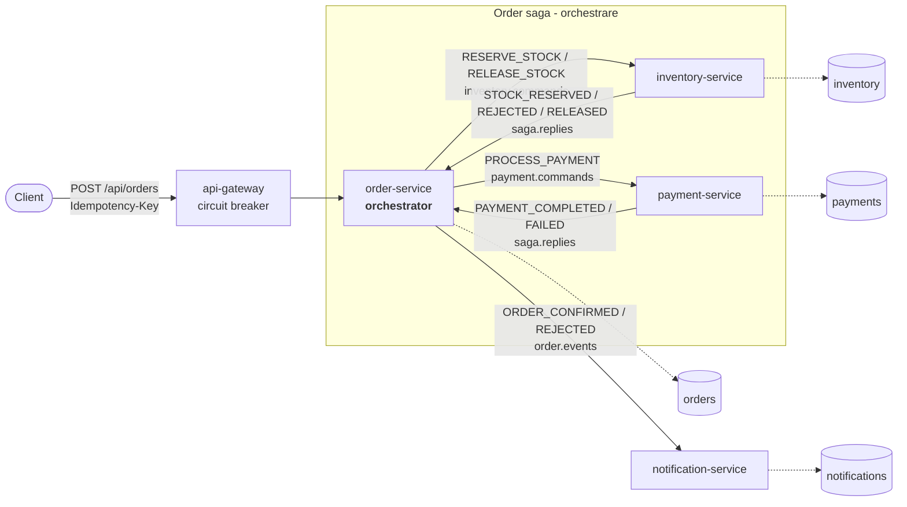

# Order Platform

Sistem de comenzi pe microservicii (Java 21, Spring Boot 3.4, Kafka, PostgreSQL) construit ca proiect de portofoliu / teren de exercițiu pentru subiectele de nivel senior: **saga**, **transactional outbox**, **consumatori idempotenți**, **observabilitate**, **Kubernetes** și **CI/CD GitOps**.



Fiecare serviciu își scrie mesajele într-un tabel **outbox**, în aceeași tranzacție cu modificarea de business; un publisher le trimite apoi în Kafka. Fiecare consumator deduplică după `messageId`.

## Fluxul unei comenzi

```
PENDING --STOCK_RESERVED--> STOCK_RESERVED --PAYMENT_COMPLETED--> CONFIRMED
   |                              |
   | STOCK_REJECTED               | PAYMENT_FAILED  (compensare: eliberează stocul)
   v                              v
REJECTED  <--STOCK_RELEASED--  COMPENSATING
```

`POST /orders` răspunde **202** imediat; rezultatul final se citește cu `GET /orders/{id}`. Aceeași cheie `Idempotency-Key` returnează comanda existentă (**200**).

## Rulare rapidă

Cerințe: JDK 21+, Docker. (Pentru Kubernetes: `kind`, `kubectl`, `helm`.) Maven wrapper e inclus.

```bash
make help            # toate comenzile
make apps-up         # build imagini (Jib) + infrastructură + 5 servicii în docker compose
make demo            # rulează scenariile: succes, stoc insuficient, plată refuzată (compensare), idempotență
```

Sau doar infrastructura, cu serviciile pornite din IDE (`./mvnw -pl order-service spring-boot:run` etc.):

```bash
make infra-up
```

| URL | Ce e |
|---|---|
| http://localhost:8080/api/orders | API (prin gateway, cere `Authorization: Bearer <JWT>`; token de dev: `scripts/token.sh`) |
| http://localhost:3000 | Grafana (dashboard „Order Platform - Overview”, Explore → Tempo pentru trace-uri) |
| http://localhost:9090 | Prometheus (reguli de alertă în `docker/prometheus/alerts.yml`) |
| http://localhost:8089 | Kafka UI |

Plata e refuzată când totalul depășește `payment.max-amount` (implicit 1000), așa se declanșează compensarea. Stocul demo: `SKU-LAPTOP`, `SKU-PHONE`, `SKU-MOUSE`, iar `SKU-RARE` are un singur exemplar.

### Kubernetes (kind)

```bash
make kind-up             # cluster local (api-gateway pe :8080, Grafana pe :3000)
make k8s-local           # imagini -> kind, deploy overlay local
make k8s-observability   # Prometheus + Grafana + Tempo (helm), PodMonitor, alerte, dashboard
```

### CI/CD

* `ci.yml` (PR + main): `mvn verify` (include testele Testcontainers), scanare Trivy (dependențe + misconfigurări K8s), validare manifeste cu kubeconform.
* `cd.yml` (după CI pe main): imagini cu Jib → GHCR, scanare Trivy a imaginilor, commit cu noile tag-uri în `k8s/overlays/prod`.
* `argocd/application.yaml`: ArgoCD sincronizează clusterul din Git (GitOps). Înlocuiește `OWNER` în `k8s/overlays/prod/kustomization.yaml` și în `argocd/application.yaml`.

## Structura

```
platform-commons/     "golden path": outbox, idempotent consumer, DLT/retry, contract mesaje, observabilitate
order-service/        API + orchestratorul saga
inventory-service/    rezervă / eliberează stoc
payment-service/      plată simulată
notification-service/ consumator de evenimente
api-gateway/          Spring Cloud Gateway + Resilience4j
docker/               config Postgres, Prometheus (+alerte), Tempo, Grafana (dashboard provisionat)
k8s/                  base + overlays (local, prod) + stack observabilitate (helm)
.github/workflows/    CI și CD        argocd/   aplicația GitOps
load-test/            k6              docs/adr/ deciziile de arhitectură
```

## Unde se vede fiecare subiect de interviu

| Subiect | Unde în cod | Ce să povestești |
|---|---|---|
| Saga orchestrată + compensare | `order-service/.../SagaOrchestrator.java` | Mașina de stări, de ce ignori mesajele care nu se potrivesc stării, compensarea ca pas explicit. [ADR-001](docs/adr/001-saga-orchestration.md) |
| Transactional outbox | `platform-commons/.../outbox/*` | Problema dual-write, `FOR UPDATE SKIP LOCKED` pentru mai multe replici, `Propagation.MANDATORY`, livrare at-least-once. [ADR-002](docs/adr/002-transactional-outbox.md) |
| Consumator idempotent | `IdempotencyGuard.java` | `INSERT ... ON CONFLICT DO NOTHING` în aceeași tranzacție cu efectul. [ADR-003](docs/adr/003-idempotent-consumers.md) |
| Idempotență la API | `OrderService.create` | `Idempotency-Key` + index unic + tratarea cursei dintre două cereri identice. |
| Concurență | `ProductRepository.lockBySkus`, `OrderRepository.findForUpdate` | Lock pesimist în ordine stabilă (evită deadlock), serializarea răspunsurilor pe aceeași comandă. |
| Erori Kafka | `KafkaPlatformConfig` | Retry cu backoff exponențial, DLT, excepții neretriabile (mesaj malformat). |
| Database per service | `docker/postgres`, `application.yml` | Fiecare serviciu are propria bază; fără JOIN-uri între servicii. [ADR-004](docs/adr/004-database-per-service.md) |
| Observabilitate | `platform-defaults.yml`, `docker/grafana`, `docker/prometheus/alerts.yml` | Metrici RED + metrici de business (`orders_finished_total`, `orders_saga_duration_seconds`), `outbox_pending`, lag Kafka, trace distribuit prin HTTP → outbox → Kafka, alerte pe SLO. |
| Reziliență edge | `api-gateway/.../ResilienceConfig.java` | Circuit breaker + timeout + fallback 503 cu `Retry-After`. |
| Securitate edge | `api-gateway/.../SecurityConfig.java`, `GatewaySecurityTest` | OAuth2 resource server reactiv, JWT HS256 în dev / JWKS prin `issuer-uri` în prod, 401 pentru lipsă/expirat/semnătură greșită. |
| Kubernetes | `k8s/base/*` | Probe startup/liveness/readiness, graceful shutdown + `preStop`, securityContext restrictiv, HPA, PDB (prod), NetworkPolicy. |
| CI/CD + GitOps | `.github/workflows`, `argocd/` | Build fără Dockerfile (Jib), scanări, promovare prin commit în Git, nu prin `kubectl` din pipeline. |

## Ce am verificat efectiv și ce nu

Verificat în această sesiune:

* Build complet și **23 de teste** (orchestrator, inventory, payment, securitatea gateway-ului) trec.
* **Rulare reală end-to-end** cu PostgreSQL 16 și Kafka 3.9 (KRaft) pornite local, fără Docker, și cele 5 servicii ca procese Java: migrările Flyway și `ddl-auto: validate` trec, scenariile din `make demo` dau rezultatele așteptate, stocul se restaurează după compensare.
* **Reziliență**: cu payment-service oprit, comanda rămâne `STOCK_RESERVED` și devine `CONFIRMED` după repornire (nu se pierde nimic).
* **Concurență**: 300 de comenzi trimise câte 20 în paralel pe același SKU, toate `CONFIRMED`, outbox gol, stoc consistent, niciun mesaj în DLT.
* `traceId` apare în logurile order → payment → notification pentru aceeași comandă (propagarea prin outbox și Kafka funcționează).

**Neverificat** (nu aveam Docker, kubectl sau acces la un cluster / GitHub): imaginile Jib, `docker-compose.yml`, testele Testcontainers (`OrderSagaIntegrationTest`, se sar singure fără Docker), vizualizarea în Grafana/Tempo, manifestele Kubernetes (doar sintaxa YAML a fost validată), workflow-urile GitHub Actions, scriptul k6. Rulează `make build` cu Docker pornit ca primă verificare; dacă ceva din lista asta nu merge din prima, spune-mi și îl reparăm.

## Limitări cunoscute și pași următori

* Outbox cu **polling** (simplu, fără componente extra). Alternativa la scară mare: Debezium CDC (vezi ADR-002).
* Gateway-ul validează JWT (HS256 cu secret partajat în dev; în producție setează `JWT_ISSUER_URI` către IdP-ul tău). Serviciile din spatele lui nu revalidează tokenul (zero-trust ar cere asta + mTLS). Lipsește **rate limiting** (necesită Redis).
* Kafka e single-node și parola bazei de date e de dev; în producție: Kafka gestionat / Strimzi cu replicare 3 și secrete din External Secrets / Vault.
* Fără **versionarea contractelor de mesaje** (Schema Registry / Avro) și fără teste de contract (Pact / Spring Cloud Contract).
* Încă nu există un job care re-procesează mesajele din DLT.
* Idei de extindere: CQRS + Event Sourcing pe `order-service`, chaos testing cu Toxiproxy, virtual threads vs. WebFlux, native image GraalVM.
